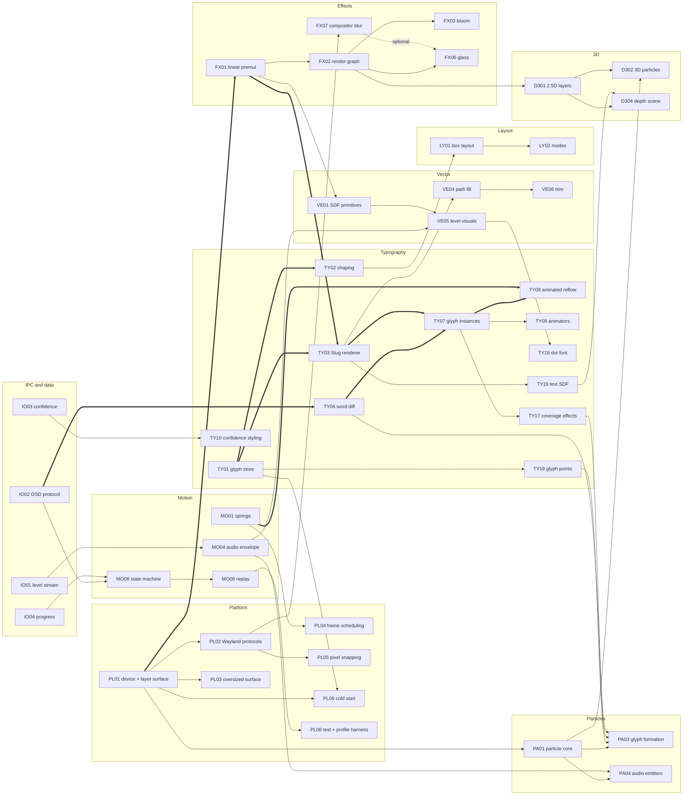

# Voxtype Renderer Capability Map

Date: 2026-10-26. Input for the renderer product plan and roadmap. Built from every file in `/var/tmp/claude/renderer-plan/`: the six mockup inference files (`mockups-c01-08.md`, `mockups-c09-16.md`, `mockups-c17-24.md`, `mockups-v03-09.md`, `mockups-v12-17.md`, `mockups-v21-22.md`) and the six research files (`research-typography.md`, `research-vector.md`, `research-effects.md`, `research-particles.md`, `research-animation.md`, `research-platform.md`). The spike report `~/work/voxtype-osd-spike/REPORT.md` did not exist when this was written, so no spike numbers are used.

## How to read this

- **Labels.** **[V]** verified, with a source (a link, a local file, or a mockup file that verified it from the image). **[I]** inferred from verified facts or normal practice. **[G]** guessed, needs a measurement or a decision. Every effort figure is [G].
- **Mockup ids.** `01` to `24` are round 1 concepts. Oystein's six picks are the families **03** (dynamic island, mid-screen), **09** (particle words), **12** (Swiss sci-fi, closest), **17** (command palette), **21** (dot matrix, overall style) and **22** (mission control, simplified). Each family is the parent plus 12 variants (`min`, `rich`, `light`, `warm`, `cool`, `green`, `serif`, `ticker`, `tall`, `finish`, `pasted`, `glass`), so 78 picked designs in all.
- **Picks column.** Which picked families need the capability, with M (must), S (should) or C (could) as the mockup files tagged them. "6M" means all six picked families need it at must. A variant name such as `21-ticker` means only that variant. This column is weighted highest when ordering work.
- **Others column.** Round 1 concepts outside the picks that need it. Lower weight.
- **Effort.** S under 1 week, M 1 to 3 weeks, L 3 to 6 weeks, XL over 6 weeks, for one developer working with AI help. All [G].
- **Risk.** Low, Med, High, with the reason when it is not Low.
- **Depends on.** Capability ids that must exist first.

## Summary

1. The map has 112 capabilities in 10 domains. 34 of them are needed at must by every design in all six picked families, and 9 more are must in all six families but only in some variants (such as `finish`, `pasted`, `glass`). Section 0 lists both sets. The 34 are the phase 1 core. [V, counted from the Picks column of the tables below]
2. The core is text first. In all 78 picked designs the transcript is the hero, and almost every motion cue lives on words. The hardest shared problem is a paragraph whose words change several times a second without jumps: word identity diff (TY06), per-glyph instances (TY07) and animated reflow (TY08). [V, `mockups-v12-17.md` section 4; `mockups-v21-22.md` part 4]
3. The glyph renderer is a Slug-style analytic coverage shader (TY03). Lengyel dedicated the Slug patent to the public domain on 2026-03-17 and published MIT reference shaders. [V, https://terathon.com/blog/decade-slug.html, as read by `research-vector.md`] The same curve data must feed particles, text masks, outline morphs and later 3D extrusion, so the glyph store (TY01) is designed once for all of them.
4. Family 09 is the only picked family that needs a GPU particle system at must, and it needs it in all 13 of its designs. Glyph-target formation (PA03) is the highest-risk visual feature. [V, `mockups-v03-09.md` capability list]
5. Family 12 needs no shader effects and is the most demanding on typography: 56 px text, 1 physical pixel hairlines, tabular figures, digit roll. It is the best first target. [V, `mockups-c09-16.md` section 12]
6. No picked design needs 3D at must. 12 designs in family 09 want a tilted 3D ring at should. The tilted ring (D301, D302) comes with family 09 in phase 3; full 3D scenes are phase 6. The pass list, transforms and the depth rule must allow it from day one (section 3, items 8 and 17). [V, `mockups-v03-09.md`; `mockups-v21-22.md` says "No design implies 3D" for 21 and 22]
7. The biggest platform risks are cold start (160 to 207 ms first frame, reported in the task brief from earlier session measurements; no log file was found, so phase 0 measures it again) and whether KWin applies `ext-background-effect-v1` blur to a layer-shell surface, which the six glass variants need. [V for the protocol on this machine, `research-effects.md` section 2; layer-shell support unverified]
8. Three data gaps block designs as drawn: per-word confidence (17 must), a target-app name for "Pasted into FrankenTerm" (all pasted variants), and telemetry such as VRAM and latency (22 must). The daemon does not send confidence today. [V, no `confidence` field outside `src/meeting/` in `~/work/voxtype/src`]

9. The real daemon has more states than the mockups show: on-demand model loading, live typing (streaming), a post-process step, cancel with backspaces, no speech, clipboard-only and file output, and a recording limit. IO10 and the state motions in section 4 cover them. [V, `~/work/voxtype/src/state.rs`, `~/work/voxtype/src/config/schema.rs`]
10. Accessibility is a domain of its own (AX), with reduced motion in MO09. It is phase 1 work. [I]

## 0. Core sets

**The 34 core capabilities** (must in every design of all six families): TY01, TY02, TY03, TY04, TY06, TY07, TY08, VE01, VE04, VE05, FX01, FX02, MO01, MO02, MO03, MO04, MO05, MO06, MO07, MO08, LY01, LY03, PL01, PL02, PL03, PL04, PL06, PL07, PL08, PL09, PL10, IO01, IO02, IO09.

**The 9 variant-wide capabilities** (must in all six families, but only in some variants): TY15 (`ticker`, `tall`), VE09 (`finish`), FX04 (`ticker`, `tall`, digit roll), FX06 and FX07 (`glass`), FX14 (`light`), LY02 (`ticker`, `tall`), IO04 (`finish`), IO05 (`pasted`).

The capabilities added after review (TY24 to TY26, PL13 to PL15, IO10, AX01 to AX04) are not counted in either set because no mockup tags them; ROADMAP.md schedules PL13 to PL15, IO10, TY25, TY26 and AX01 to AX04 in phase 1. [V, counted from the Picks column]

## 1. Capability catalogue

### 1.1 Typography (TY)

| ID | Capability | Picks | Others | Technique | Effort | Risk | Depends on |
|---|---|---|---|---|---|---|---|
| TY01 | **Glyph store.** Load bundled and system fonts, read outlines, metrics and variation axes, keep curves in one GPU buffer keyed by font, glyph id and axis values. | 6M | all | `skrifa` (fontations). Cubics split to quadratics on the CPU. Pre-bake the bundled font's curve and band data into an mmap-able blob so cold start does no font work. [I, `research-typography.md` sections 1, 13; `research-platform.md` section 5] | M | Low | none |
| TY02 | **Shaping and paragraph layout.** Kerning, ligatures (the "ffi" in "office" is visible in the mockups), OpenType features, bidi, line breaking, clusters. | 6M | all | Phases 1 to 4: `harfrust` directly, `unicode-linebreak` for break opportunities, our own line fitter, behind an adapter trait, about 200 lines, so `parley` and `fontique` stay off the cold path. Right-to-left runs are shaped but mixed lines are not reordered. Phase 5: `parley` (0.11 at the time of writing) with `harfrust` behind the same adapter for bidi and itemisation. Pin versions. [V, https://docs.rs/crate/parley/latest, https://linebender.org/blog/tmil-25/; I for the split, `review-fable.md` 4.5] | M | Med: pre-1.0 API churn | TY01 |
| TY03 | **Analytic GPU glyph renderer.** Exact coverage from quadratic curves per pixel, sharp at any size, rotation, scale or perspective, no atlas. | 6M | all | Slug algorithm. The port rewrites the reference data layout (curves in an RGBA16F texture with shared endpoint texels, bands in an RG16U texture, sorted by max x or max y for early exit); textures or storage buffers is a phase 0 decision. Must keep: straight horizontal lines only in vertical bands and vice versa, straight segments as `{p1, p2, p2}`, dynamic dilation with the full MVP so perspective works. Snap font size so `size * capHeight` is whole pixels. Used for anything animated or 14 px and over; small static text uses TY26. [V, https://terathon.com/blog/decade-slug.html, https://github.com/EricLengyel/Slug README] Grayscale AA only (overlay sits on arbitrary content). [I] | L (about 3 weeks for the port [G]) | Med: data layout rewrite, thin strokes | TY01, FX01, PL01 |
| TY04 | **Text contrast and gamma.** Coverage in linear light, luminance-tuned contrast, stem darkening, premultiplied output, light-on-dark and dark-on-light. | 6M (must in all light variants, `12` thin strokes) | 16 (thin font) | Skia or DirectWrite style contrast curve as a shader uniform. [I, `research-typography.md` section 4] | S | Med: tuning by eye on both GPUs | TY03, FX01 |
| TY05 | **Font fallback.** Norwegian letters, CJK, emoji, any script the recogniser outputs. | 6S | 23 M (kanji), 07 | `fontique` over fontconfig, queried lazily only when a glyph is missing, so start-up skips enumeration. A glyph no font has draws as the missing-glyph box; text is never dropped. [I] | S | Med: enumeration cost in a per-recording process [G] | TY02 |
| TY06 | **Word identity diff.** Turn each new hypothesis into a word list aligned to the previous one, with stable word ids and states: new, kept, substituted, removed, tentative, committed. | 6M | all | Word-level Myers diff (`similar` crate) with a character-similarity cost for substitutions, so "there" to "their" is one changed word. Stability rule: committed after about 600 ms or 2 unchanged hypotheses. The final text (`source: final`, from a separate final pass, sometimes another engine) is diffed against the whole live paragraph, so matching words keep their ids and only real changes crossfade. Diff window: last 200 words, under 1 ms per revision [G]. [I, `research-typography.md` section 12; `mockups-v03-09.md` observation 1; V for the separate final pass, memory note `voice-typing-voxtype.md`] | M | High: quality depends on real revision streams and the final swap, not tested yet | IO02 |
| TY07 | **Glyph instance pipeline.** One GPU instance per glyph with position, scale, rotation, skew, opacity, colour, axis values, blur, effect id, mask parameters, word id, 3D transform slot. | 6M | all | Instance buffer written each frame from the motion core, or computed in a shader from per-word state. 1000 instances is trivial. [I] | M | Low | TY03, TY06 |
| TY08 | **Animated reflow.** Shape and break lines at the target layout at once, then let each word spring to its new place (FLIP). Covers centred re-centring, rewrap travel, line roll, overflow scroll. | 6M | all | Per-word 2D position spring keyed by word id, reading-order stagger of 12 ms on rewrap, wrap decided once on commit and never mid-animation. [I, `research-animation.md` section 2.6] | M | Med: centred text moves on every word (09, 03 parents) | TY06, TY07, MO01 |
| TY09 | **Text animator system.** After Effects style range selectors (start, end, offset, shape) over glyphs, words or lines, plus audio-reactive selectors. | 09M 12M 17M 21M 22M 03S | 13, 14, 16, 20, 23 | Evaluate selector per glyph in the shader from index, time and inputs, then lerp properties. Springs instead of keyframes for anything a revision can interrupt. [I, `research-typography.md` section 11] | M | Low | TY07, MO01, MO05 |
| TY10 | **Tentative and confidence styling.** Tentative words lighter or dimmer, committed words solid. Three confidence levels in 17: wavy underline, underline plus fill chip, colour tint. | 17M (13 designs), 03S (`03-ticker` dims tentative word), 09M (tentative words live as particles) | 13 | Variable weight or opacity spring per word, decoration from TY12. Needs per-word confidence from IO03 or a proxy (word age). [I] | M | High: no confidence data today [V, see IO03] | TY06, TY11, TY12, IO03 |
| TY11 | **Variable font axes.** Animate wght, wdth, opsz per glyph (tentative weight, confidence, level pulse). | 12S 17C 21S (`21-serif` opsz) 22C | 07, 08, 19, 20, 24 C | Re-instance through `skrifa` on the CPU at quantised axis steps (for example wght in steps of 25), build bands per instance, cache them, and crossfade coverage between the two nearest instances in the fragment shader. Never interpolate control points on the GPU: it breaks the Slug band order and band membership, and cubic fonts can split into different curve counts. Use a TrueType-flavoured variable font (glyf plus gvar). [V for band order, Slug README; I for the fix, `review-fable.md` 4.2] | M | Med: needs an OFL TrueType variable font with the axes and Norwegian coverage | TY01, TY03 |
| TY12 | **Text decorations.** Underline (straight, wavy, gradient, draw-on), strikethrough, highlight chip, all tied to a word's measured bounds and following its spring. | 17M, 22S (underline sweep), 12C, 03C | 13, 14 M, 23 S | SDF lines and the Slug path fill drawn as word-attached instances. [I] | S | Low | TY07, VE03, VE06 |
| TY13 | **Numerals and labels.** Tabular and lining figures, slashed zero, tracked caps and small caps, mono labels, odometer digit roll on the changed digit only. | 12M 22M 03M 09M 21S 17C | 06, 18 | OpenType `tnum`, `smcp` features through TY02. Roll is a per-digit clip mask plus vertical spring. [I] | S | Low | TY02, TY07, FX04 |
| TY14 | **Caret.** Blink at about 1.06 Hz, solid while words arrive and 400 ms after, glides to the end of text, block variant. | 17M 22M (caret in 22 variants) 21M (`21-light`) 12S (`12-ticker`) | 06, 13, 18 | Caret is a word-attached instance following the last word's spring. [I] | S | Low | TY08 |
| TY15 | **Text windows and masks.** Right-anchored single-line ticker window, left ellipsis, edge fade masks of 24 to 60 px, bottom-anchored scrolling history, age dimming per line. | 6M in `ticker` and `tall` variants | 13, 14 | Layout runs on the full text, a window offset springs, an SDF or R8 mask fades the edges. [I] | S | Low | TY08, FX04 |
| TY16 | **Dot-matrix type.** Status text in a 5x7 dot font drawn as instanced dots; assemble and dissolve letters; morph between two strings. | 21M (12 designs) | none | Dot font as data (grid bitmaps per glyph), rendered by VE05 dot instances, so dots can be shared with the waveform and particles. [I, `mockups-v21-22.md` part 2] | M | Low | VE05, TY02 |
| TY17 | **Glyph coverage effects.** Per-glyph blur-in, noise-threshold dissolve, left-to-right reveal wipe, gradient fill, core-plus-halo glow, chromatic offset. | 09M (dissolving word edge), 12S 17S 03S 21S (reveal) | 13 M, 16 M, 20 M, 24 M | Inside the Slug fragment shader: dilate the quad, use an approximate distance from the curves for blur and halo, threshold noise for dissolve. Large blurs go through an offscreen text layer (FX02). [I] | L | Med: analytic coverage has no exact blur, quality needs testing | TY03, FX02, FX10 |
| TY18 | **Glyph point sampling.** 200 to 800 points per glyph along the outline and inside the fill, cached per glyph id and size. | 09M | 24 S, 15 C | Flatten `skrifa` outlines, resample by arc length, rejection-sample the interior on the CPU once per glyph. Later: GPU sampling. [I, `research-particles.md` section 2.3] | S | Low | TY01 |
| TY19 | **Text distance field.** A low-resolution SDF or mask of the current text, rebuilt per frame, for glow, outlines, particle collision and 3D scene interaction. | 09S (particles hug glyphs), 03S 22S (`rich` glow) | 15, 20 | Render Slug coverage into an R8 or R16F target at half resolution, then a jump-flood pass. [I] | M | Low | TY03, FX02 |
| TY20 | **Size morph and mixed sizes.** Smooth text size changes (40 to 28 px on paste, 12% shrink of an older paragraph) and lines of different size in one block. | 21M 22M (`pasted`), 12M (`tall`) | 14 M | Free with TY03: scale instances, never re-rasterise. Wrap is fixed during the move. [I] | S | Low | TY03, TY08 |
| TY21 | **Glyph outline morph.** Morph one glyph or word into another by matched contours. | none | 24 C | Arc-length resample, match contours by area and centroid, fade the extras. Replaced by crossfade or particles for revisions. [I, `research-vector.md` path morphing] | L | High: contour counts and holes differ | TY01, VE07 |
| TY22 | **Colour glyphs (COLRv1).** Emoji and layered colour fonts. | none | none | Walk the `skrifa` paint graph, draw layers with TY03 plus gradients. [I] | M | Low | TY03, VE08 |
| TY23 | **Text on a path.** Glyphs placed and bent along a curve. | none | 13 (edge glow, could), 20 | Arc-length placement, per-glyph rotation, small vertex-stage bends. [I] | M | Low | TY07, VE04 |
| TY24 | **Scramble-resolve and typewriter.** Per-character reveal in order, and stepped random characters that resolve to the real ones. | 21M (dot variant of `word-revise`) | 11 M, 18 | Per-glyph index and a seeded hash in the animator (TY09); glyph swap on the CPU per step. Reduced motion shows the final text at once. [V for the tags, `mockups-c09-16.md` and `mockups-c17-24.md` capability lists] | S | Low | TY07, TY09 |
| TY25 | **Balanced and centred wrapping, controlled measure.** Lines of near-equal length for centred text, a maximum measure in characters. | 03M 09M (centred parents) | 01 to 08 (T5) | Line fitter searches the narrowest width that keeps the same line count; wrap decided on commit, fixed during motion. [I] | S | Med: centred text moves on every word | TY02, TY08 |
| TY26 | **Hinted small static text.** Labels, timestamps and chips at 9 to 12 px that never change size. | 12M (9 to 11 px tracked caps, 12 px mono timestamp), 22M 17M (labels) | most | skrifa hinting (TrueType interpreter or autohinter), skrifa's scan converter, a small R8 cache texture, textured quads. Rebuilt only on scale or theme change. The design picks Slug or hinted per text run. [V, https://github.com/googlefonts/fontations/blob/main/skrifa/README.md; V that Slug ignores hinting, Slug README] | S | Low | TY01, TY02 |

### 1.2 Vector shapes (VE)

| ID | Capability | Picks | Others | Technique | Effort | Risk | Depends on |
|---|---|---|---|---|---|---|---|
| VE01 | **SDF primitive shader.** Rounded rect with per-corner radii, capsule, squircle, circle, ring, arc, line, dot. Fill, stroke, hairline, analytic AA. | 6M | all | One instanced uber-shader, Inigo Quilez distance functions, `clamp(0.5 - d/fwidth(d))` coverage. About 300 lines of WGSL [G]. Squircle by superellipse exponent near 5 [I]. [V for a WGSL squircle in the wild: https://github.com/CapSoftware/Cap/pull/1038] | M | Low | PL01, FX01 |
| VE02 | **Shape morph.** Animate size, radius and corner exponent; dot to capsule to panel; chamfered panel to capsule; smooth-min merge of two shapes. | 03M 21M (`ticker`) 22M (`ticker`) 09S 12S 17S | 01, 05, 08 | Lerp primitive parameters on springs; smooth-min for merges. [I] | S | Low | VE01, MO01 |
| VE03 | **Strokes and hairlines.** Lines that stay exactly 1 physical pixel, dashes, joins, caps. | 12M 21M 22M 17M 03S 09S | 16, 18 | SDF for lines, arcs and rounded polylines; `kurbo` stroke-to-outline then Slug fill for general paths. Pixel snapping from PL05. [I, `research-vector.md` strokes] | M | Med: snapping versus smooth motion (section 3.12) | VE01, VE04, PL05 |
| VE04 | **General path fill.** Icons (mic, check, stop, gear, brain, chip, timer, X), chamfered frames, corner brackets, notches. | 6M | all | Same Slug curve shader as glyphs; `kurbo` for path maths. Icons stored in the glyph store. [I, `research-vector.md` recommended stack] | S | Low | TY03, TY01 |
| VE05 | **Level visuals.** Instanced bars, ticks and dots from the level history: round caps, per-instance colour ramp by height or index, dotted tails, whole-dot quantisation, peak colours, playhead colouring for progress. | 6M | all | Vertex pulling from a ring buffer uploaded each frame, window function for the symmetric envelope. [I] | S | Low | VE01, MO04 |
| VE06 | **Path trim and draw-on.** A distance-along-path parameter for check draw, ring close, outline draw-on from corners, hairline open, light heads running along a border. | 6S, M in `pasted` variants of 21 and 22 | 02, 11, 16 M | SDF arcs carry an angle parameter; Slug paths carry a precomputed arc length per curve. [I] | M | Low | VE03, VE04 |
| VE07 | **Icon morph.** Mic to check, dot to square, ring to spinner to check. | 03S 09S 21S | 19 S | `kurbo` contour resampler for a small fixed icon set, or crossfade with trim. [I] | S | Low | VE04, VE06 |
| VE08 | **Gradients.** Linear, radial, conic, along a stroke; animated conic rims; OKLab interpolation; dithered. | 03M 09M 17M 22M (`rich`) 12C 21C | most | In-shader for 2 or 3 stops, small ramp texture otherwise; blue-noise dither (FX09). [I] | S | Low | FX01, FX09 |
| VE09 | **Progress and spinner components.** Determinate bar or arc that springs toward the value and never moves backwards; indeterminate shimmer; 270 degree arc spinner with eased head and tail. | 6M in `finish` variants | most | Composite of VE01, VE06 and MO01. [I] | S | Low | VE01, VE06, MO01, IO04 |
| VE10 | **Widgets.** Sparklines, segment meters with peak hold, micro bars, key-cap badges, chips with icon and chevron, corner brackets. | 22M (13 designs), 17M (chips, 12 designs), 21S | 18, 23 | Built from VE01, VE04 and TY13 inside LY01 boxes. [I] | M | Low | VE01, VE04, TY13, LY01 |
| VE11 | **Smooth variable-width ribbon.** A thick glowing line from samples or a sum of travelling sines. | 21M (`21-rich`) 09S (ribbon can be particles instead) 17S (`17-rich` swoosh) | 15, 16, 19, 24 M | GPU line from samples with analytic AA and width per vertex, or SDF of a polyline. [I] | M | Low | VE01, FX05 |
| VE12 | **Soft shadows.** Drop shadow and long shadow (light mode), inner shadow. | 6S, M in `light` variants | 01, 05, 08 | Closed-form Gaussian of a rounded rect (Evan Wallace method) in the SDF shader, no blur pass. [I] | S | Low | VE01 |
| VE13 | **Arbitrary SVG content.** Imported vector art beyond the icon set. | none | none | `vello_hybrid` behind a feature flag, only if needed. Pre-1.0. [V, https://github.com/linebender/vello] | L | Med: memory and API churn | PL01 |

### 1.3 Effects and shaders (FX)

| ID | Capability | Picks | Others | Technique | Effort | Risk | Depends on |
|---|---|---|---|---|---|---|---|
| FX01 | **Linear premultiplied compositing.** Rgba16Float scene in linear light, premultiplied alpha, one blend state, glow writes alpha, tone map shoulder only above 1.0, sRGB out. | 6M | all | `CompositeAlphaMode::PreMultiplied`, blend One / OneMinusSrcAlpha. [I, `research-effects.md` sections 3, 9] | S | Med: PreMultiplied on NVIDIA Wayland is untested | PL01 |
| FX02 | **Render graph with layers.** Fixed pass list, transient texture pool, layer groups with opacity, clip and blend mode, optional offscreen target per layer so an effect can apply to text only, particles only, or the panel. | 6M | all | Two fixed pass lists, not an engine. Direct path for designs with no whole-frame effect (12): scene straight into the swapchain, sRGB encode in the shader, premultiplied. Effect path: scene in Rgba16Float, bright extract, pyramid down, pyramid up, glass, composite, tone map. [I, `research-effects.md` section 5; `review-fable.md` 5.2] | M | Low | FX01 |
| FX03 | **Bloom.** Wide, stable glow on bars, particles, rims and accent words. | 09M 03S/M (`rich`) 22S/M (`rich`) 17S 21S 12C | 02, 04, 06, 07, 10, 11, 13, 15, 16, 18, 19, 20, 23, 24 | Call of Duty: Advanced Warfare pyramid: 13-tap downsample with Karis average, 3x3 tent upsample, lerp blend. [V, https://www.iryoku.com/next-generation-post-processing-in-call-of-duty-advanced-warfare/] | M | Low | FX02 |
| FX04 | **Masks and clips.** Rounded clip by SDF multiply, R8 mask textures, edge fades. | 6M (`ticker`, `tall`, digit roll) | 13, 14 | SDF multiply for shapes, R8 target for arbitrary masks. [I] | S | Low | FX02, VE01 |
| FX05 | **Analytic glow.** Glow and outer halo straight from a shape's distance, no blur pass. | 03S 21S 22S 12S 09M | 16 M | Exponential falloff of the SDF distance; cheaper than bloom and resolution independent. [I, `research-effects.md` section 6] | S | Low | VE01 |
| FX06 | **Glass material.** Frosted base, bevel normal from the panel SDF, refraction of our own layers, Fresnel, rim light, dispersion, tint, grain. | 6M in `glass` variants, 17S (`rich`) | 01, 05, 08, 14, 19 | Own WGSL, about 80 lines [G]; bake the 1D Snell displacement profile at startup. [V for the technique, https://cdn.jsdelivr.net/npm/@ybouane/liquidglass@1.0.3/README.md] The fake frosted look is the base; real desktop blur is an upgrade (FX07). Without compositor blur, nothing from the desktop shows through, so the fake is a tinted panel with a bevel. The tint must be solid enough that text meets 4.5:1 over pure white and pure black backdrops (AX01); this rule replaces adaptive contrast over an unknown backdrop. A wallpaper snapshot is rejected, because windows sit behind the overlay. Built: `Element::panel(..).glass(Glass::dark() | Glass::light())` in `vo_scene::glass`, drawn by `vo_render::glass` in the display list pass with bevel, Fresnel, rim light with dispersion, grain, drop shadow and sheen; `Glass::contrast` checks the tint in linear and sRGB blending (dark 92% tint, light 78%); goldens in `gpu_glass.rs`. Refraction of our own layers is not built yet. [V, `glass_demo` example] | L | Med: the look is built and gated; at the tint AX01 needs, the desktop shows mainly through the edge band | FX02, FX03, VE01, FX10 |
| FX07 | **Compositor blur behind.** Real blur of the desktop under the panel shape. | 6M in `glass` variants (6 designs) | 01, 05, 08, 19 | Request a region through `ext-background-effect-v1`, built from rectangles rounded outward to whole logical pixels, updated with the surface commit at most once per frame; one band per pixel row of the corner radius (the stair-step test showed coarser bands leave visible steps; `vo_render::glass::blur_region`). Sent through the host as `SurfaceChange::Blur`. KWin 6.8.1 blurs behind a layer-shell surface and takes a new region with every commit: 299 regions in 299 commits at 60 fps followed a moving panel in a nested session. `org_kde_kwin_blur` is gone. [V, `blur_probe` example in a nested `kwin_wayland --virtual`, and `wayland-info` on the real session] The protocol has no blur strength, so a blur radius cannot be animated. | S | Low: verified on KWin 6.8.1; lag against commit timestamps and 120 Hz not measured | PL02, VE01 |
| FX08 | **Rim light, sheen and animated borders.** Specular edge, one-shot sheen sweep, rotating conic rim, a bright segment orbiting the border. | 03M (`rich`) 17M (`rich`) 22M (`rich`, `glass`) others S | 01, 04, 08, 16, 19, 24 | Conic gradient on the SDF stroke with an angle offset; ambient loops capped at 30 fps and stopped on finish. [I] Built in two places. Glass panels draw their own rim light, sheen and orbiting segment (`vo_scene::glass`), because they read the bevel normal and keep clear of the text. Every other shape uses `Element::rim` and `Element::sheen`; on a glass panel, turn off the glass's own `sheen` and `orbit` to use those instead. Both follow reduced motion and step the orbit at 30 fps, measured live in `glass_demo --app-live --still`. [V] | S | Low | VE08, FX05 |
| FX09 | **Dither and grain.** Blue-noise dither against banding in dark gradients and glows, optional luminance grain under 3%. | 6S | all | 64x64 blue-noise texture (about 16 KB), offset per frame. [I] | S | Low | FX01 |
| FX10 | **Procedural noise library.** Hash, 3D simplex, curl, fbm, domain warp in WGSL. | 09M 03C 22C (grain) | 01, 07, 15, 19, 24 | Hand-written WGSL, time as the third axis. [I] | S | Low | none |
| FX11 | **Feedback buffer.** Persistence and trails: phosphor fade, comet tails. | 09S (`09-ticker` comet, `09-rich` trails) | 18 M, 24 S | One extra target, multiply-fade then draw. [I] | S | Low | FX02 |
| FX12 | **Motion blur and streaks.** Directional blur on moving words and bars, light streaks leaving the capsule. | 03M (`rich`) 09M (`rich`) 17S 12S (`rich`) | 13 | Velocity-stretched quads for particles; per-instance velocity from springs drives a short directional blur in TY17. [I] | M | Low | FX02, MO01, TY17 |
| FX13 | **Style pack.** Chromatic aberration, glitch slices, scanlines, CRT curvature, vignette, flicker. | 22C (scan texture) | 02, 04, 06, 07, 11, 18, 20, 23 | Composite-pass effects, 3 samples each. Flash limits from MO09. [I] | S | Low | FX02 |
| FX14 | **Light-mode shading.** No additive glow, alpha-blended particles, shadows instead of bloom, dark-on-light text tuning. | 6M in `light` variants | none | Blend mode chosen per layer by theme. [I, `mockups-v03-09.md` observation 5] | S | Low | FX02, LY03, TY04 |
| FX15 | **HDR output and colour tagging.** Extended linear swapchain, tag the surface through `wp_color_manager_v1`. | none | none | Pipeline is HDR-ready (FX01), output stays SDR until NVIDIA support is checked. [V for wgpu colour spaces, https://wgpu.rs/doc/wgpu/enum.SurfaceColorSpace.html] | M | High: NVIDIA Vulkan WSI support unknown | FX01, PL02 |
| FX16 | **Bokeh and depth-of-field sprites.** Out-of-focus orbs and size-by-depth particles. | 09M (`09-rich`) | none | Soft disc sprites with size and blur by depth. [I] | S | Low | PA06 |

### 1.4 Particles (PA)

| ID | Capability | Picks | Others | Technique | Effort | Risk | Depends on |
|---|---|---|---|---|---|---|---|
| PA01 | **GPU particle core.** Storage buffers, one compute pass per step, fixed-slot pools per emitter and per word, fixed time step, vertex pulling with `draw_indirect`, no readback. 2k to 100k particles. | 09M (13 designs) | 24 M, others C | Own system, about 600 lines of Rust and WGSL. TU Wien reports about 10 million particles at 63 fps on a GTX 1060. [V, https://www.cg.tuwien.ac.at/research/publications/2023/PETER-2023-PSW/PETER-2023-PSW-.pdf] | M | Med: added pipelines on the cold path | PL01, FX01 |
| PA02 | **Force library.** Curl noise, point, ring and line attractors, swirl, drag, gravity, wind, impulses. | 09M | 15, 24 | Divergence-free curl noise (Bridson et al. 2007). [I] Attractors are O(N), no neighbour search. | S | Low | PA01, FX10 |
| PA03 | **Glyph-target formation.** A word forms from particles that converge on its glyph points, then hands over to the solid Slug glyph without a pop. Revisions scatter and re-form only changed words. Committed words freeze to solid text. | 09M (13 designs) | 24 M, 20 S, 21 S | Targets from TY18, assignment by sorted position so points travel short distances, spring plus curl wobble, solid glyph fades in at about 60% convergence, stable pool per word slot. [I, `research-particles.md` section 2.3; `mockups-v03-09.md` family 09 baseline] | L | High: legibility delay (target under 200 ms to readable) and look need real revision streams | PA01, PA02, TY18, TY06, TY17, MO01 |
| PA04 | **Audio-reactive emitters.** Ring or vortex whose radius, swirl speed, brightness and size follow the level; particle ribbons whose amplitude is the level history travelling outward. | 09M | 24 M, 10, 15 | Level envelope and history in the frame uniform block (MO04). [I] | M | Low | PA01, MO04 |
| PA05 | **Bursts and shockwaves.** Paste burst past the panel edge, shockwave ring, error jitter and collapse, scatter. | 09S (M in `09-pasted`) 21C 22C | 15, 16, 24 | Impulse plus drag plus curl noise; shockwave as an SDF ring. [I] | S | Low | PA01, PA02 |
| PA06 | **Sprite rendering.** Additive soft sprites, velocity stretch, lifetime colour ramp, alpha-blended dark-on-light variant. | 09M | 24 M | Additive needs no sort; light mode uses premultiplied alpha. [I, `research-particles.md` section 2.8] | S | Low | PA01, FX01, FX14 |
| PA07 | **Trails.** Comet and streak trails. | 09S (`rich`, `ticker`) | 24 S | Velocity stretch first; feedback buffer (FX11) second; ribbons only for a few hundred hero particles. [I] | S | Low | PA06, FX11 |
| PA08 | **Text-mask interaction.** Particles avoid, hug or glow along glyph edges. | 09C | 24 | Sample TY19 in the compute pass. [I] | M | Low | TY19, PA02 |
| PA09 | **Grid-snapped dot particles.** The 21 dot grid as particles: dots peel off on dismiss, assemble into the check or the dot font. | 21C | none | Same pool with targets snapped to the grid pitch. [I] | S | Low | PA01, VE05, TY16 |

### 1.5 Animation and motion (MO)

| ID | Capability | Picks | Others | Technique | Effort | Risk | Depends on |
|---|---|---|---|---|---|---|---|
| MO01 | **Spring core.** Closed-form solution for under, critically and over damped springs, 1D and N-D, retarget keeps velocity, settle detection, dt clamped at about 50 ms. | 6M | all | About 40 lines for the solver. Ryan Juckett and Allen Chou formulas. Apple's "Designing Fluid Interfaces" (WWDC 2018) is the reference for redirectable motion. [I, `research-animation.md` section 2.1] | S | Low | none |
| MO02 | **Signal smoothers.** Second-order dynamics with f, zeta and response r, so each signal has its own feel. | 6M | all | t3ssel8r "SecondOrderDynamics" form. [I] | S | Low | MO01 |
| MO03 | **Keyframe tracks.** Cubic Bezier, steps, loops, for one-shot beats (paste check, error shake). Output adds onto spring targets. | 6M | all | About 150 lines. [I] | S | Low | MO01 |
| MO04 | **Audio envelope and history.** Attack and release, peak hold, onset flag, history ring, interpolation to display rate with a playout delay. | 6M | all | Exists in part: the GTK OSD `FrameRing` keeps 3 s at 100 Hz with a 50 ms playout delay. [V, `~/work/voxtype/src/osd/ipc.rs` lines 25 to 30] The playout delay is a design token (`level.playout_ms`, default 50 ms); the latency target is measured after it. | S | Low | IO01 |
| MO05 | **Stagger and sequencing.** Stagger as a function of index with a cap on total time; short labelled sequences (finishing, pasted, hide). | 6M | all | No general timeline engine. [I] | S | Low | MO01, MO03 |
| MO06 | **State machine.** Statechart-lite with parallel regions (text, level visual, panel, status): idle, show, listening, finishing(progress), pasted(enter), error, hide. Sets targets only, never values, so every transition is interruptible. | 6M | all | Rust enum plus transition table; settle detection decides when to go idle. [I, `research-animation.md` section 2.5] | M | Low | MO01, IO02 |
| MO07 | **Motion and theme tokens, hot reload.** Spring presets, durations, colours, sizes, placement, playout delay in TOML files (the one token format, same as the voxtype config), compiled-in defaults, one base file per family and one override per variant, user overrides in `~/.config/voxtype/overlay/`, validated with size and range limits. Reload without losing spring state, dev builds only. | 6M | all | `notify` file watch; swap at a frame boundary. Scenario files stay RON because only tools write them. [I] | S | Low | MO01, LY03 |
| MO08 | **Deterministic time and scenario replay.** The renderer takes time as input, seeds all noise, and replays scripted scenarios (level, revisions, states) to PNG contact sheets and golden traces. | 6M | all | Pure function of (state, inputs, dt). Particle sim at fixed dt with fixed seeds so goldens also cover particles. [I] | M | Low | MO06, PL08 |
| MO09 | **Reduced motion and quality tiers.** A switch that shortens or removes travel, caps flashes at 3 per second (WCAG 2.3.1), and drops bloom, particles and glass on a weak GPU, on battery, or after a GPU allocation failure. Every state change keeps a visible cue. | 6S; reduced motion is phase 1 | 11 M (flash limits), 18 | Reduced motion from config, CLI and env per project rule 5, plus Plasma's animation speed (`AnimationDurationFactor` in `kdeglobals` [G, key name not verified]). Battery trigger from UPower [G]. [V for the flash rule, https://www.w3.org/WAI/WCAG22/Understanding/three-flashes-or-below-threshold.html] | S | Low | MO07, FX02 |

### 1.6 Layout and components (LY)

| ID | Capability | Picks | Others | Technique | Effort | Risk | Depends on |
|---|---|---|---|---|---|---|---|
| LY01 | **Box layout with animated size.** Rows, columns, a tile grid (22), chips (17), a status area that changes shape per state, a container that follows the text extent. | 6M | all | Small flex-like solver run at target layout; springs animate sizes and positions. Text measurement without drawing. [I] | M | Low | TY02, MO01 |
| LY02 | **Layout modes and mode morph.** Card, ticker, tall history, pasted compaction; morph between them (22 panel folds into a pill). | 6M (each family has `ticker` and `tall`) | 13, 14 | Modes are parameter sets of one component tree, not separate designs. [I, `mockups-v12-17.md` section 4] | M | Med: three modes multiply test cases | LY01, VE02, TY15 |
| LY03 | **Theme tokens.** OKLab colours, accent per state, light and dark, follow the KDE colour scheme. | 6M | all | Colour variants become one token file each. Parent designs map Plasma roles: panel fill from Window background, text from Window ForegroundNormal, listening accent from the global accent, paste from ForegroundPositive, error from ForegroundNegative, finishing from ForegroundNeutral. `warm`, `cool` and `green` override the scheme. A scheme colour under the contrast bar (AX01) falls back to the design palette; a high-contrast scheme gives a plain opaque look with no effects. Read at show time. sRGB to OKLab at token load, to linear in the shader. The GTK stopgap's parser `src/osd/plasma.rs` is in the working tree, uncommitted and being changed [V, `git status` in `~/work/voxtype`]; reuse it once it lands, with no KDE library dependency. [I] | S | Low | none |

### 1.7 3D (D3)

| ID | Capability | Picks | Others | Technique | Effort | Risk | Depends on |
|---|---|---|---|---|---|---|---|
| D301 | **2.5D layers.** Perspective matrix, depth buffer, tilt and parallax of flat layers. | 09S (tilted ring), 17C 12C | 04, 08, 14, 20 M | Each layer has a 4x4 transform from day one; orthographic by default. Slug coverage stays sharp under perspective. [I] | S | Low | FX02, TY03 |
| D302 | **3D particles.** Point cloud with a camera and depth (the 09 ring as a tilted torus). | 09S (12 designs) | 15 | Same compute system with z. [I] | S | Low | PA01, D301 |
| D303 | **SDF raymarched hero shapes.** Glowing orb, metaball, liquid blob, no assets. | none | 01 S, 05 M, 15 | Tile-limited fragment raymarch. [I] | M | Low | FX02, FX10 |
| D304 | **Depth-ordered scene graph.** Background, 3D scene with depth test, particles without depth write, 2D vector, text, post. Scenes read the text SDF to react to words. | none (future) | 15, 20, 24 C | Fixed ordering rules in FX02 plus TY19. [I, `research-particles.md` section 4] | M | Low | D301, TY19 |
| D305 | **Floor reflection and light cone.** Reflected copy with fade, volumetric cone. | 09S (`09-rich`) | 20 S | Flipped layer render plus gradient fade; cone as an additive gradient. [I] | S | Low | D301, FX02 |
| D306 | **Extruded 3D text.** Glyph outlines extruded into meshes, lit. | none | 20 C | Triangulate outlines (`lyon`), extrude, simple lighting. [I] | L | Med | TY01, D304 |
| D307 | **glTF and PBR scenes.** Imported meshes, materials, lights. | none | 05, 08 C | Reject until a design requires it; memory and start-up cost against the per-recording process. [I] | XL | High: memory | D304 |

### 1.8 Platform and performance (PL)

| ID | Capability | Picks | Others | Technique | Effort | Risk | Depends on |
|---|---|---|---|---|---|---|---|
| PL01 | **Device and layer surface.** wgpu on Vulkan, `smithay-client-toolkit` layer shell: overlay layer, no keyboard, empty input region, mid-screen, one surface on one output. | 6M | all | Decided earlier. `ash` only as a contained presenter fallback. [I, `research-platform.md` sections 2, 3] | M | Low | none |
| PL02 | **Wayland protocol set.** `wp_fractional_scale_v1`, `wp_viewporter`, `wp_presentation`, `ext_background_effect_manager_v1`, FIFO through the driver. | 6M | all | All present on this KWin 6.8.1, plus `wp_fifo_manager_v1`, `wp_commit_timing_manager_v1` and `wp_color_manager_v1` v3. [V, `wayland-info` in `research-effects.md` section 2 and in `review-fable.md` 5.5] On other compositors each missing protocol turns a feature off: no fractional scale means integer scale, no presentation means frame-callback time, no background effect means fake glass. | S | Low | PL01 |
| PL03 | **Oversized surface and damage.** Transparent margin (120 to 200 px) around the panel for glow, shadow and particles; the panel resizes inside it with no surface reallocation. | 6M | all | Fixed surface per mode, panel drawn inside; reallocate only on mode change. Margin sized from the output size, so a 1366 x 768 output gets a smaller one. At scale 2 a 1400 x 900 surface is about 10 MB per swapchain image [I, arithmetic]; the memory ledger reports it on its own line. | S | Med: memory per buffer at 2x scale | PL01 |
| PL04 | **Frame scheduling.** One frame per frame callback, `PresentMode::Fifo`, max latency 1, time-based animation, zero frames when everything is settled, ambient loops capped at 30 fps. | 6M | all | `Fifo`, never `Mailbox` (the spike picks `Mailbox` when offered, which burns frames). Settle flags from MO01 plus a CPU-side model of particle activity (section 3.6). Budgets scale with the refresh period; 60, 75, 120, 144 Hz and VRR are in scope. [I, `review-fable.md` 5.5] | S | Med: NVIDIA pacing history on KWin [V, https://invent.kde.org/plasma/kwin/-/work_items/124] | PL01, MO01 |
| PL05 | **Pixel exactness at fractional scale.** Hairlines and dot centres snapped to physical pixels at 1.25x and 1.5x; text baselines snapped when settled. | 12M 21M 6S | 18 | Render at the exact fractional buffer size; snap in the vertex shader using the scale factor. [I] | S | Med: see section 3.12 | PL02 |
| PL06 | **Cold start.** First frame within budget (target under 150 ms cold, under 30 ms warm, both [G]): precompiled SPIR-V, disk pipeline cache, parallel Wayland and device init, pre-baked font blob, particle and bloom pipelines compiled after the first frame, optional keep-warm process. | 6M | all | Vello saw about 200 ms versus 5 ms with a warm Mesa cache. [V, https://github.com/linebender/vello/issues/485] NVIDIA keeps its own cache, so our gain may be smaller [G]. The CPU first frame (PL13) may remove the latency need for keep-warm. | L | High: 160 to 207 ms reported in the brief, no log found | PL01, TY01 |
| PL07 | **Process model and supervision.** Spawn per recording, optional keep-warm window, daemon watchdog, restart limit, fallback to the GTK OSD. | 6M | all | The daemon already supervises an OSD child. [V, `~/work/voxtype/src/osd/supervisor.rs` exists] | M | Low | IO02 |
| PL08 | **Test and profile harness.** Headless offscreen render, lavapipe goldens in CI, NVIDIA goldens locally, `bench` subcommand (p50, p99, PSS), Tracy zones, wgpu timestamp queries, startup stage log. | 6M | all | Startup stage log comes first; every budget depends on it. [I, `research-platform.md` sections 11, 12] | M | Low | PL01, MO08 |
| PL09 | **Budgets.** GPU p99 under 2 ms, CPU render under 1.5 ms p99, PSS visible under 150 MB, CPU under 3% of one core while the CPU transcribes, no wakeups when hidden. | 6M | all | Numbers from `research-platform.md` section 13, all [G] until measured on both GPUs. | S | Med | PL08 |
| PL10 | **Shader workflow.** WGSL source, compiled to SPIR-V at build time, dev-only hot reload inside a validation error scope that keeps the old pipeline on error. | 6M | all | `notify` plus `create_shader_module`. [I, `research-effects.md` section 10] | S | Low | PL01 |
| PL11 | **Button hit regions.** An input region for one button over a click-through surface. | 17C (gear, X) 21C (`rich`, `tall`) 22C (`ticker`, `finish` Cancel) | 14 | Product decision: draw buttons as display only, or give only the button an input region. [I] | S | Med: product decision | PL01 |
| PL12 | **Output choice.** Pick the output with the focused window or cursor; follow scale and transform changes. | 6S | 13 M | Daemon passes the output name at spawn. How the daemon learns it on KWin is phase 0 question Q11: a KWin script over D-Bus, or `kscreen-doctor` [G for both]. Output unplugged mid-recording: hide, keep recording, re-create on the new choice. Rotated outputs: KWin applies the buffer transform; snapping uses the transformed pixel grid. | S | Med | PL01 |
| PL13 | **CPU first frame.** Panel shape, hairline and status line drawn on the CPU into a `wl_shm` buffer on a second surface while Vulkan starts, then a one or two frame crossfade to the GPU surface. | 6M (latency) | all | `tiny-skia` or our own rect fill plus skrifa's scan converter. Two surfaces, because switching one surface from shm to a Vulkan swapchain is not safe to rely on with this driver. Phase 0 question Q9. [I, `review-fable.md` 5.1; G for the 15 to 25 ms estimate] | S | Med: untested on NVIDIA | PL01, TY26 |
| PL14 | **Failure handling and diagnostics.** The failure matrix in ROADMAP.md 4.11: never an opaque panel, exit on daemon loss, render-loop heartbeat, refuse CPU adapters, device loss, allocation failure, stale font blob, `--probe` and `--diagnose`. | 6M | all | Startup alpha-mode check, exit codes for the launcher, supervisor counters. [I, `review-completeness.md` section 8] | M | Med: a visible failure is the worst user outcome | PL01, PL07 |
| PL15 | **Placement.** Anchor (centre by default), vertical offset, grow anchor for size changes, per design as tokens. | 6M | all | Layer-shell anchors plus margins, computed from the output size. [I; V that layer shell has no anchor with explicit size, `research-platform.md` section 3] | S | Low | PL01, PL03 |

### 1.9 IPC and data (IO)

| ID | Capability | Picks | Others | Technique | Effort | Risk | Depends on |
|---|---|---|---|---|---|---|---|
| IO01 | **Level stream.** 100 Hz frames of `{seq, min, max, peak_dbfs}`, 16 bytes, over `$XDG_RUNTIME_DIR/voxtype/audio.sock`, lossy broadcast. | 6M | all | Exists. [V, `~/work/voxtype/src/audio/levels.rs` header] | none | Low | none |
| IO02 | **Unified OSD protocol.** One versioned socket with `Phase` (reliable), `Text` (revision number plus full hypothesis or `{stable_len, tail}`), `Level` (droppable), snapshot semantics. | 6M | all | Today the GTK OSD reads live text and status from files (`live_preview_path`, `live_status_path`). [V, `~/work/voxtype/src/bin/voxtype_osd_gtk4.rs` around line 563] Replace with the socket, `postcard` encoding, clean failure on version mismatch. Delivery per kind: `Level` and `Text` overwrite-latest (by revision number for `Text`), `Phase` and `Config` queued and never dropped. `Text` carries `source: live or final`. Heartbeats both ways, the overlay's from its render loop. [I, `review-fable.md` 5.3] | M | Med: backwards compatibility with the GTK OSD | none |
| IO03 | **Per-word confidence and stability.** Confidence per word from the engine, or a stability proxy. | 17M (13 designs), 03S 09S | 13 | Not sent today. [V, see summary point 8] Engines differ; a proxy from word age and revision count works for all. [I] | M | High: engine-dependent | IO02 |
| IO04 | **Finishing progress.** Fraction and seconds of audio left. | 6M in `finish` variants | most | Exists as status text such as "Finishing: 8 s of audio left". [V, comment in `voxtype_osd_gtk4.rs` around line 520] Send as numbers in IO02. | S | Low | IO02 |
| IO05 | **Paste result.** Output method (typed, pasted, clipboard only, file), Enter sent flag, time taken, target app name. | 6M in `pasted` variants | most | Enter flag and method are known to the daemon, which has the fallback chain wtype, dotool, ydotool, clipboard [I; V for the chain, voxtype `CLAUDE.md`]. "Pasted into" text is wrong when the text only reached the clipboard, so the design shows "Copied, press paste" then. Target app name needs a KWin query. [G] | S | Med: app name source unknown | IO02 |
| IO06 | **Telemetry.** Elapsed time, word count, words per minute, level in dBFS, model name, latency, mic name; VRAM. | 22M 17M (chips) 12M (duration, words) 03M (timer) | 18 M | Cheap fields from the daemon; VRAM needs NVML, which costs memory in the overlay process. [I, `mockups-v21-22.md` part 4] | S | Med: VRAM cost | IO02 |
| IO07 | **Spectrum bands.** FFT band energies at 100 Hz. | none must | 10 M, 02, 04, 06, 07 S | A window function over the level history gives the symmetric envelope the mockups show, so bands are optional. [I, `mockups-v12-17.md` section 1] | S | Low | IO01 |
| IO08 | **Paragraph markers.** A pause signal that starts a new paragraph in the `tall` variants. | 12M 21M 22M (`tall`) | none | Live preview already splits at 0.8 s pauses after 6 s (commit 6179f5e). [V, `git log` in `~/work/voxtype`] Expose the split as an event. | S | Low | IO02 |
| IO09 | **Error kind and message.** Typed error with a short user message. | 6M | all | Part of `Phase`. No mockup draws the error state; all error specs are [G]. Oystein approves each family's error look at its phase gate. | S | Low | IO02 |
| IO10 | **Real daemon states.** `loading_model` (on-demand model load), `streaming` (text typed into the app live), `finishing` with a `transcribe` or `post_process` stage, `empty` (no speech), `cancelled` (with the characters rewound), `limit_warning` before `max_duration_secs`. | 6M (no mockup, invented per family) | all | Map from the daemon's `State` enum (Idle, Recording, EagerRecording, Transcribing, Outputting, Streaming) and the cancel path. [V, `~/work/voxtype/src/state.rs`; `on_demand_loading` in `src/config/schema.rs`] Meeting mode is out of scope. | M | Med: touches hot daemon code | IO02 |

### 1.10 Accessibility (AX)

| ID | Capability | Picks | Others | Technique | Effort | Risk | Depends on |
|---|---|---|---|---|---|---|---|
| AX01 | **Contrast gate.** Body text at least 4.5:1 against the panel fill, text 24 px and over at least 3:1, tentative words included, in every variant. Glass checked over pure white and pure black. | 6M (every variant) | all | Ratio computed from token colours in the golden suite. Sets the dim floor for tentative words (TY10, `word-commit`). [I; V for the 4.5:1 and 3:1 values, WCAG 2.2 success criterion 1.4.3] | S | Low | LY03, TY04 |
| AX02 | **Non-colour cue.** Every phase told apart by an icon or a word, not only by hue. | 6M | all | Required in every variant; colour-vision simulation of the `green` variants in CI. [I; V that colour carries state in the mockups, `mockups-v21-22.md` line 317] | S | Low | VE04 |
| AX03 | **Hide transcript.** Show level and state only, for screen sharing and recording. | 6S | all | Built from the `min` variants, set by config, CLI and env. [I] | S | Low | LY02 |
| AX04 | **User scale.** One `scale` token for all sizes, with a 10 px floor for the smallest label. | 6S | all | Multiplies layout and type tokens; Plasma's font size is not followed automatically. [I] | S | Low | MO07 |

## 2. Dependency graph

The graph shows the main edges. The tables above are the full list. Thick arrows mark the phase 1 critical path to family 12.

Reading the graph [I]:
- Two roots carry most of the weight: the glyph store (TY01) and the device with linear premultiplied compositing (PL01, FX01). Everything visible sits on them.
- The word diff (TY06) depends only on the protocol (IO02). It is pure CPU code and can be built and tested against recorded revision streams before any GPU work exists.
- Particles (PA03) sit at the end of the longest chain: glyph store, glyph points, word diff, glyph instances, coverage effects. That is why the phase 1 text path must already expose word ids and glyph slot positions.

## 3. Interactions that must be designed in from the start

Each item names the shared data or contract that has to exist in phase 1, even when the feature using it ships later. All items are [I] unless marked.

1. **One glyph source for every consumer.** The glyph store (TY01) holds curves keyed by font, glyph id and variation coordinates. The Slug renderer, icon fill, particle target sampling (TY18), the text SDF (TY19), outline morph (TY21) and 3D extrusion (D306) all read it. No second font pipeline, no atlas. A change of axis value must invalidate the cached particle targets and the text SDF for those glyphs.

2. **Particles take glyph outlines as targets.** The layout API must give a word's glyph positions and word id before the word is visible, because 09 and 24 form the word where it will land. [V, `mockups-c17-24.md` observations] The particle pool is keyed by the same word id as the text instances, so a revision retargets only the changed word. The handover rule is fixed: the solid Slug glyph fades in from about 60% convergence, and committed words are always solid glyphs, so legibility never depends on the simulation.

3. **Shaders on text layers, two levels.** Cheap per-glyph effects (reveal wipe, dissolve threshold, tint, halo) run inside the Slug fragment shader, selected by an effect id in the glyph instance. Expensive effects (large blur, bloom, chromatic split, glass refraction of text) need the text drawn into its own layer target. The render graph (FX02) must support a per-layer offscreen target from the start, and the glyph instance format must reserve the effect id and parameters.

4. **The panel shape is one SDF used everywhere.** The panel's SDF (VE01 parameters on springs) drives fill, hairline border, shadow (VE12), analytic glow (FX05), glass bevel and refraction (FX06), clip masks for text (FX04) and the compositor blur region (FX07). `ext-background-effect-v1` takes a region, so the rounded shape must be approximated by rectangles and updated as the shape morphs. Region updates go with surface commits, so throttle them to the frame rate. The input region stays empty in every case unless PL11 adds a button.

5. **One signal bus drives all motion.** Inputs (level frames, revision events with word ids, phase, progress, confidence) become smoothed signals (MO02, MO04). Signals set spring targets (MO01). Springs write the glyph instance buffer and one per-frame uniform block: time, level envelope, peak, onset, progress, state weights, accent colour. Every shader and the particle compute pass read that same block, so a level pulse can reach text, bars, rim light and particles with one mapping. The state machine (MO06) only sets targets.

6. **Settle detection includes the GPU.** CPU springs know when they are settled; GPU particles do not without a readback, which we ban. Each emitter therefore has a CPU-side activity model (spawn time, lifetime, last impulse) so the frame scheduler (PL04) knows when it can stop drawing.

7. **Revision timing contract.** Revisions arrive every 100 to 200 ms. [V, `mockups-v21-22.md` part 3] No revision animation may run longer than about 250 ms, and every one must be interruptible mid-flight. Text effects, particle re-formation and decoration springs all follow this, and the word diff merges revisions that arrive during a transition instead of queuing them.

8. **3D compositing with text.** Every layer and instance carries a full transform from day one, with an orthographic camera as the default, so 2D is the special case of 3D. Fixed order: background, 3D scene with depth test, particles with depth test and no depth write, 2D vector, text, post effects. Text stays in the Slug path even when placed in 3D, because analytic coverage stays sharp under perspective. Scenes react to words by sampling the text SDF (TY19), never by reading the text layout directly.

9. **Surface margin is shared by glow, shadow and particles.** Particles and bloom leave the panel in 09 [V, `mockups-v03-09.md` observation 3]. The oversized surface (PL03) is sized from the largest of particle overflow, bloom radius and shadow, per layout mode. The blur region (FX07) covers only the panel; the input region covers nothing.

10. **Light mode changes blend modes, not designs.** Theme tokens (LY03) choose additive or premultiplied alpha per layer, and bloom or shadow per element. Particles, glow and text contrast must all take the blend choice as a parameter from the start. [V, `mockups-v03-09.md` observation 5]

11. **Determinism for tests.** The renderer reads time only from its input, all noise is seeded, and particles step at a fixed dt. Then the same scenario replay (MO08) gives the same frames for text, vector and particles, and golden tests (PL08) cover the whole picture.

12. **Pixel snapping versus motion.** Hairlines and dots in 12 and 21 must sit on whole physical pixels, but snapping a moving element makes it jitter. Rule: snap only static or settled elements, and fade between snapped and unsnapped positions as a spring settles. This has to be in the vertex stage from the start because it touches every primitive.

13. **Variable axes, particles and decorations share word bounds.** When a tentative word's weight springs to committed, its width changes. Underlines, highlight chips, caret position and particle targets must all follow the word's live bounds, not the bounds at layout time.

14. **Bloom is selective.** Bloom reads an emissive mask, not the whole scene, so body text stays sharp while bars, accents and particles glow. The emissive flag lives in the glyph and shape instance formats.

15. **Quality tiers cut whole branches.** The reduced-motion and low-power tier (MO09) must be able to drop bloom, particles, glass and ambient loops without a different code path for the core. Each optional pass in FX02 and each emitter needs an off switch that still leaves a correct picture.

16. **The final text is not a tail revision.** The live words and the final text come from different passes, sometimes different engines, so at the end the whole paragraph can change: punctuation, casing, a word in the middle, merged or split words. The word model diffs the final text against the whole live paragraph, the protocol marks it `source: final`, and `settle-to-final` runs before `paste-confirm`. [V for the separate final pass, memory note `voice-typing-voxtype.md`; I for the rule, `review-fable.md` 4.1]

17. **Depth rule for 3D, decided now.** Text and 2D vector never write depth. They draw after the 3D scene, back to front, and 3D objects may sit behind text, never in front of it. Anti-aliased edges against a depth buffer are the one 3D problem that could force a format change, and this rule avoids it. [I, `review-fable.md` 5.4]

18. **Two text paths, chosen per run.** Slug for anything animated, scaled or 14 px and over; hinted raster (TY26) for small static text. Both read the same glyph store and the same shaping output, so a label can move from one path to the other without layout changes. [I]

## 4. Motion vocabulary

The named motions below are shared across the designs. Each design picks a variant and token values. Timings come from the mockup files and are all [G] starting values to tune on screen. Base tokens follow `mockups-v12-17.md` section 1:

| Token | Definition |
|---|---|
| `snap` | Critically damped spring, about 120 ms to 98% |
| `soft` | Critically damped spring, about 220 ms |
| `slow` | Critically damped spring, about 360 ms |
| `pop` | Underdamped spring, damping ratio 0.7, about 6% overshoot, about 280 ms |
| `out` | cubic-bezier(0.2, 0.8, 0.2, 1), for one-shot tracks only |
| `in` | cubic-bezier(0.4, 0, 1, 1), for one-shot tracks only |
| `linear` | Constant speed, for spinners and orbits only |

General rules for every motion:
- Anything a revision, a level change or a state change can interrupt is a spring. Keyframe tracks are only for one-shot beats, and they add onto a spring target.
- Family 12 and 22 use no overshoot. Family 03 and 09 allow `pop`. Family 21 uses stepped or quantised versions where noted.
- Audio-driven values never wait for an intro; the first words arrive 300 to 700 ms after the key. [I, `mockups-v21-22.md` family 22 base]
- Reduced motion (MO09): travel, scale, blur, scramble, shake and particles are removed; state changes become 100 to 150 ms opacity fades; colour tweens and draw-on of the check stay, shortened to 120 ms; ambient loops stop. Every state keeps its icon or word (AX02).
- Flashes stay under 3 per second (WCAG 2.3.1).

| Name | Trigger | Spec | Used by | Needs |
|---|---|---|---|---|
| `panel-show` | Recording starts | Variants: **grow-from-dot** (capsule grows width then height, 260 to 320 ms, `pop` 4%, content fades in at 70% open with 40 ms stagger: 03, 21-ticker); **hairline-open** (2 px line draws left to right 160 ms, then height `soft` 220 ms, content 40 ms stagger top to bottom: 12); **scale-fade** (scale 0.94 to 0.97 up to 1.0, rise 6 to 8 px, 200 to 280 ms `soft`: 17, 21, 09); **power-up** (outline draws from corners 260 ms, tiles rise 8 px with 40 to 60 ms stagger, values count up: 22). Whole intro done by about 380 to 520 ms. | all | VE02, VE06, MO05, LY01 |
| `panel-hide` | Hide after pasted, error or cancel | Reverse of `panel-show`, faster (160 to 300 ms, `in`). Glow and particles go last (09: particles inhale to the mic 300 ms). Process stops drawing after the last frame. | all | MO06, PL04 |
| `word-arrive` | New word in a hypothesis | Fade 0 to 1, rise 4 to 8 px, blur 3 to 8 px down to 0, 120 to 160 ms `out`. Letter stagger 18 to 25 ms where used; several words in one update stagger 30 to 35 ms with total capped at 200 ms. Earlier words do not move sideways (12) unless the line is centred. Serif variants: no large blur, 3 px rise. | all | TY07, TY09, TY17 |
| `word-form` | New word in family 09 or 24 | 120 to 300 particles per word converge from the right of the cursor on glyph points over 300 to 500 ms with curl wobble; colour cyan to white; solid glyph fades in from about 60% convergence over 180 ms, drawn in the same emissive layer as the particles, with particle brightness dropping by the same amount so the word's total light stays flat (no pop); letters resolve left to right (25 ms per letter); leftover dust drifts right and fades in 600 ms. | 09, 24 | PA03, TY18, TY17 |
| `word-revise` | A tracked word changes | Default: old word lifts 3 to 4 px and fades 80 to 100 ms, new word drops in 120 to 140 ms, accent tint decays to white over 300 to 600 ms. Particle variant: changed word scatters 120 ms and re-forms 300 ms from the same points. Dot variant: 3 stepped scramble frames of 30 ms. Neighbours follow with `reflow-glide`. Total under 250 ms. | all | TY06, TY08, TY17, PA03 |
| `word-commit` | Word unchanged for about 600 ms or 2 hypotheses | Tentative to committed: opacity 55 to 70% up to 100% (the low end is raised per theme until tentative text keeps 4.5:1, AX01), optional weight axis spring (quantised instances with a coverage crossfade, TY11), tint clears. In 09 the word freezes from particles to solid. | 03, 09, 17 | TY06, TY10, TY11 |
| `reflow-glide` | Word width change, rewrap, re-centre | Words spring to new positions, `soft` 180 to 240 ms, no overshoot; rewrap travels in reading order with 12 ms stagger; wrap fixed during the move. | all | TY08 |
| `line-roll` | Overflow at the bottom of a fixed card | Lines move up one line height (180 to 360 ms, `soft` or `slow`); the oldest line fades under a 40 px top mask in the first 120 to 160 ms; older lines dim by age (`age-dim`). | 03, 09, 12, 21, 22 (`tall`) | TY15, FX04 |
| `ticker-advance` | New word in a single-line strip | Right-anchored window shifts left by the new word's width, 140 to 180 ms `soft`; the oldest word fades through a 24 to 60 px left mask; ellipsis fades in once truncation starts; brightness drops 12% per older word. | all `ticker` variants | TY15 |
| `age-dim` | New paragraph or line in history | Previous line dims to grey (70, 50, 35%) over 300 ms and may shrink 12% (`soft`); timestamp turns from accent to grey. | `tall` variants | TY20, IO08 |
| `capsule-morph` | Content size or mode changes | Container width, height and corner radius follow content on springs: 200 to 320 ms; `pop` 4% in 03, critically damped in 12, 21, 22. Also dot to capsule to dot, chamfered panel to pill (22-ticker). | 03, 21, 22, all `ticker` | VE02, LY02 |
| `level-follow` | Every level frame (100 Hz) | Asymmetric envelope: attack 10 to 20 ms, release 60 to 180 ms (instrument feel in 12 uses 10 and 60); interpolate to display rate with a playout delay set by the design token `level.playout_ms` (default 50 ms); height floor so silence still shows a line or dot row; peak hold 400 to 600 ms then one segment per 80 ms; colour ramp by height or index. 21 quantises to whole dots with a 40 to 60 ms ease on the lit state. | all | MO04, VE05 |
| `level-pulse` | Level drives a non-bar element | Ring radius `R + 0.12 R * level` on a spring (09), swirl speed 0.3 to 1.5 rev/s, record ring scale 1.0 to 1.08, rim brightness +10% at peaks, glow radius by bar height. | 03, 09, 22 (`min` has no waveform) | MO04, PA04, FX08 |
| `idle-breath` | Listening with a live mic | Record dot opacity 1.0 to 0.55 and scale 1.0 to 0.85 on a 1.2 to 1.6 s loop; silence keeps a slow shimmer so the overlay never looks frozen. Capped at 30 fps when nothing else moves. | 03, 09, 21 | MO03, PL04 |
| `finish-enter` | Recording stops | Bars or dots collapse to a calm line or the centre row over 250 to 300 ms `soft` (no scroll after); record dot cross-fades to a spinner (180 to 200 ms); status text cross-fades (100 to 150 ms); progress row slides in and the card grows about 28 px (220 ms); the last tentative word solidifies (180 ms). | all `finish` variants | MO06, VE09, LY01 |
| `progress-follow` | Progress update | Bar or arc springs toward the reported fraction, never backwards, about 300 ms; a faint highlight loops every 1.2 to 1.4 s while it stalls; indeterminate shimmer when no estimate exists; jumps to 100% in 120 ms when done. Seconds left roll once a second (`digit-roll`). | all `finish` variants | VE09, IO04 |
| `spinner-spin` | Waiting | 270 degree arc, `linear` 0.9 to 1.1 s per turn, head and tail eased on a 1.2 s loop. | all `finish` variants | VE06 |
| `paste-confirm` | Text pasted | Runs after `settle-to-final`. Progress to 100% (120 ms); ring closes (160 to 200 ms); check draws on (180 to 260 ms `out`) with a 6 to 8% `pop`; status swaps (old out left 100 ms, new in 160 ms) and accent tweens to green (160 ms, OKLab); "Enter" flashes white 120 ms when sent, never delaying the real key; transcript dims to 70% (200 ms); hold 700 to 1200 ms; then `panel-hide`. A new recording during the hold cancels it and re-enters listening with `snap`. | all `pasted` variants | VE06, VE07, MO03, IO05 |
| `paste-burst` | Text pasted, family 09 | Shockwave ring leaves the button (400 ms), ribbon particles scatter up and right past the panel edge (700 ms fade), tint wave runs through the words at 40 ms per word (accent back to white over 500 ms), status pill rises 12 px and scales from 0.9 on a 220 ms spring. | 09 | PA05, TY09 |
| `error-alert` | Error phase | Accent and border to red over 120 ms (OKLab); message replaces the status line; hold 2 to 3 s; text stays readable. Shake (2 to 3 cycles, 4 to 8 px, 280 to 320 ms decaying) only on cards; no shake on 12 or on thin pills. 09: particles jitter 150 to 250 ms then collapse. No mockup shows this state. [G] | all | MO03, LY03 |
| `digit-roll` | A number changes | Only the changed digit slides vertically, 120 to 200 ms `out`, tabular figures so width never changes. | 03, 12, 21, 22 | TY13 |
| `caret-blink` | Caret visible | 1.06 Hz, 60% duty, fade in 80 ms and out 120 ms; solid while words arrive and for 400 ms after; glides to the new end with `snap` (about 100 ms). | 17, 22, 21-light | TY14 |
| `draw-on` | Element appears or completes | Path trim from 0 to 1: hairlines 160 to 240 ms, outlines from the corners 260 ms, check 180 to 260 ms, ring close 160 to 200 ms. | 12, 21, 22, all `pasted` | VE06 |
| `underline-draw` | Low-confidence word shown or confirmed | Wavy underline draws left to right in 180 ms; fill chip fades in 120 ms; wave scrolls at 1 Hz while shown; on confirm the underline fades in 200 ms and the word eases to white. | 17, 22 (revision sweep) | TY12, IO03 |
| `rim-orbit` | Ambient while listening (rich and glass) | One bright segment orbits the border (6 s per lap, `linear`) or the conic rim rotates (6 to 12 s per turn); one-shot sheen sweep 400 to 600 ms on show; capped at 30 fps and stopped on finish. | 03, 17, 22 (`rich`, `glass`) | FX08 |
| `accent-tween` | Phase change | Accent colour moves in OKLab over 160 to 200 ms: listening accent, amber finishing, green paste, red error. | all, explicit in `green` variants | LY03 |
| `glass-focus` | Show and hide on glass variants | Blur radius 0 to 24 to 28 px over 240 to 300 ms with the fade; specular glint crosses the top edge once (400 to 500 ms). Static while listening. | all `glass` variants | FX06, FX07 |
| `dot-assemble` | Dot font text changes | Old letters dissolve into dots and new letters assemble from dots, left to right, 12 ms per letter, about 180 to 220 ms total. | 21 | TY16, PA09 |
| `stagger-in` | Groups appear (chips, tiles, bars) | 40 to 60 ms stagger in reading order; bars grow from the centre outward with 10 to 12 ms per bar. | 12, 17, 21, 22 | MO05 |
| `settle-to-final` | Final text arrives (`source: final`) | Whole-paragraph diff; unchanged words stay put; changed words crossfade in place in reading order, 150 to 250 ms total, no sideways movement for unchanged words; inserted words fade in, removed words fade out, neighbours `reflow-glide`. Runs on every recording, before `paste-confirm`. [I, `review-fable.md` 4.1] | all | TY06, TY08 |
| `scramble-resolve` | Text changes in a dot or terminal design | Each changed character steps through 2 or 3 seeded random glyphs at 30 ms, then lands, left to right with 12 ms stagger; typewriter variant reveals characters in order at 18 to 25 ms each. | 21 | TY24 |
| `cancel` | Recording cancelled | Transcript fades and slides back toward the caret in 160 ms (`in`), status shows a cross and "Cancelled" for 600 ms, then `panel-hide`. Live-typed text being rewound shows the same beat. | all | IO10, MO06 |
| `empty-result` | No speech found | Level visual settles flat, status shows "No speech" with a muted accent for 900 ms, then `panel-hide`. | all | IO10 |
| `model-loading` | Recording starts before the model is loaded | Status shows "Loading model" with `spinner-spin` or an indeterminate shimmer; the level visual still follows the mic so the overlay never looks frozen; switches to listening with `accent-tween`. | all | IO10, VE09 |
| `streaming-live` | Live typing mode | Words that have been typed into the app get a quiet "sent" mark (a dim underline or tick, design token) as they leave; at the end a short "done" beat replaces the check (open question for Oystein). | all | IO10, TY12 |
| `post-process` | Post-process step after transcription | `finishing` gets a second stage label ("Cleaning up") and an indeterminate shimmer, since the step reports no fraction. | all `finish` variants | IO10, VE09 |
| `limit-warning` | 5 s before `max_duration_secs` [G for 5 s] | Elapsed time turns amber and counts down with `digit-roll`; at the limit, `finish-enter` runs as for a normal stop. | all | IO10, TY13 |
| `mode-morph` | Layout mode changes while visible (card, ticker, tall) | Container runs `capsule-morph`; words keep ids and `reflow-glide` to the new layout; history outside the new window fades through the edge mask; caret follows the last word. | all | LY02, TY08, TY15 |
| `connection-lost` | No message from the daemon for 2 s, or the socket closes | Accent goes grey, status shows "Disconnected" for up to 1 s, panel fades out within 2 s in all, process exits. | all | IO02, PL14 |

## 5. Open questions that change this map

1. Does KWin 6.8 apply `ext-background-effect-v1` to a layer-shell surface? Decides whether FX06 glass can ever show the real desktop. (Spike, 20 lines.)
2. Is `CompositeAlphaMode::PreMultiplied` offered by the NVIDIA driver on Wayland? FX01 depends on it. The spike already requests it and prints the result, so one run per GPU answers it. If only `Opaque` is offered, the GPU overlay must not run (PL14).
3. What is the cold first frame with a disk pipeline cache and precompiled SPIR-V on both GPUs? Decides whether keep-warm (PL06, PL07) is a default or an option.
4. Can the recogniser give per-word confidence, or do we use a stability proxy? Decides TY10 and the 17 family as drawn.
5. Where does the target app name for "Pasted into FrankenTerm" come from on KWin?
6. 09-finish shows a check mark while still finishing. A spinner in the button with the check only on paste is cleaner. Needs Oystein's call. [V, `mockups-v03-09.md` 09 finishing note]
7. Buttons (X, gear, Cancel) appear in 17, 21-rich, 21-tall, 22-ticker and 22-finish. Display only, or a real input region (PL11)?
8. How long may a word stay in particle form before it feels like lag? Proposal: the solid glyph reaches 50% opacity within 200 ms of the recogniser update, judged also by eye on a contact sheet. [G]
9. Which OFL variable font with TrueType outlines (glyf plus gvar) has wght, wdth and opsz, good Norwegian coverage, and fits both the Swiss (12) and dot-matrix (21) look? Candidates: Roboto Flex (wght, wdth, opsz) and Inter 4 (wght, opsz) [I, check before deciding].
10. How does the daemon learn the target output on KWin? Decides PL12. (Phase 0 Q11.)
11. Does a CPU first frame over `wl_shm` on a second surface show in 15 to 25 ms on NVIDIA? Decides PL13 and whether keep-warm is needed for latency. (Phase 0 Q9.)
12. In live typing mode there is no paste moment. What should the end of a streaming recording look like?

## 6. Rejected or deferred

So the map is closed: each item named in a mockup file that has no capability above, and each capability no phase schedules, is listed here with its status.

| Item | Source | Status | Reason |
|---|---|---|---|
| Adaptive text contrast over an unknown backdrop | `mockups-v21-22.md` part 3 | Replaced by AX01 and the FX06 tint rule | A client cannot read desktop pixels, so there is no input signal |
| Lens-flare streaks | `mockups-v21-22.md` part 3 | Rejected | One `rich` design; FX12 streaks cover the look |
| Outline, stroked and chrome text fills | `mockups-c01-08.md` T9 | Deferred to phase 5 | No pick needs it; `kurbo` stroke then Slug fill when needed |
| Vertical CJK | `mockups-c01-08.md` T11 | Deferred | Only if concept 07 returns |
| Prompter scale and opacity ramp by line distance | `mockups-c09-16.md` (14) | Deferred | No pick; TY15 age dimming is the nearest |
| Whole-output and four-edge surfaces | `mockups-c09-16.md` (13) | Rejected | No pick; PL03 covers a margin |
| Soft-body SDF warp, verlet rope, tendrils | `mockups-c09-16.md` (15) | Rejected | No pick |
| Perspective grid, environment-mapped chrome | `mockups-c01-08.md` S8, S9 | Deferred to phase 6 | D303 covers part |
| Scrolling pattern fills, stacked depth copies of text | `mockups-c17-24.md` | Rejected | No pick |
| Animated procedural gradient, aurora, haze background | `mockups-c01-08.md` S5 | Deferred | FX10 noise can build it when a design asks |
| Right-to-left and complex scripts with full bidi | `mockups-c01-08.md` T2 | Deferred to phase 5 | Needs bidi in the word model, reflow, caret and ticker |
| IO07 spectrum bands | this map | Deferred | No pick needs it at must |
| FX13 style pack beyond the 22 scan texture | this map | Deferred | No pick needs it; flash cap applies when built |
| PA09 grid-snapped dot particles | this map | Decided at the phase 2 dot-matrix prototype | Could in 21 only |
| PL11 button hit regions | this map | Decided before phase 2 (ROADMAP open question 5) | Product decision |
| VE13 arbitrary SVG | this map | Decided when a design imports art | None does today |
| D307 glTF and PBR | this map | Rejected until a design needs it | Memory and start-up cost |
| Meeting mode display | `src/meeting/` | Out of scope | A different product surface |
| AT-SPI screen reader support | `review-completeness.md` 4.4 | Not in phases 1 to 4 (ROADMAP open question 12) | Click-through overlay; sound cues and a notification cover the non-visual channel |

## Sources

- Research inputs in `/var/tmp/claude/renderer-plan/`: `research-typography.md`, `research-vector.md`, `research-effects.md`, `research-particles.md`, `research-animation.md`, `research-platform.md`.
- Mockup inputs in the same folder: `mockups-c01-08.md`, `mockups-c09-16.md`, `mockups-c17-24.md`, `mockups-v03-09.md`, `mockups-v12-17.md`, `mockups-v21-22.md`. Images in `/var/tmp/claude/osd-shots/concepts/` and `/var/tmp/claude/osd-shots/variants/`.
- Local code checked for this map: `~/work/voxtype/src/audio/levels.rs`, `~/work/voxtype/src/osd/ipc.rs`, `~/work/voxtype/src/bin/voxtype_osd_gtk4.rs`, `~/work/voxtype/src/osd/` file list.
- Slug: https://terathon.com/blog/decade-slug.html
- Parley: https://docs.rs/crate/parley/latest ; Linebender: https://linebender.org/blog/tmil-25/
- Vello: https://github.com/linebender/vello ; pipeline cache numbers: https://github.com/linebender/vello/issues/485
- Squircle in WGSL: https://github.com/CapSoftware/Cap/pull/1038
- Background effect protocol: https://www.phoronix.com/news/Wayland-Background-Effect
- Bloom: https://www.iryoku.com/next-generation-post-processing-in-call-of-duty-advanced-warfare/
- Glass technique: https://cdn.jsdelivr.net/npm/@ybouane/liquidglass@1.0.3/README.md
- wgpu colour spaces: https://wgpu.rs/doc/wgpu/enum.SurfaceColorSpace.html
- Particles: https://www.cg.tuwien.ac.at/research/publications/2023/PETER-2023-PSW/PETER-2023-PSW-.pdf
- KWin pacing issue: https://invent.kde.org/plasma/kwin/-/work_items/124
